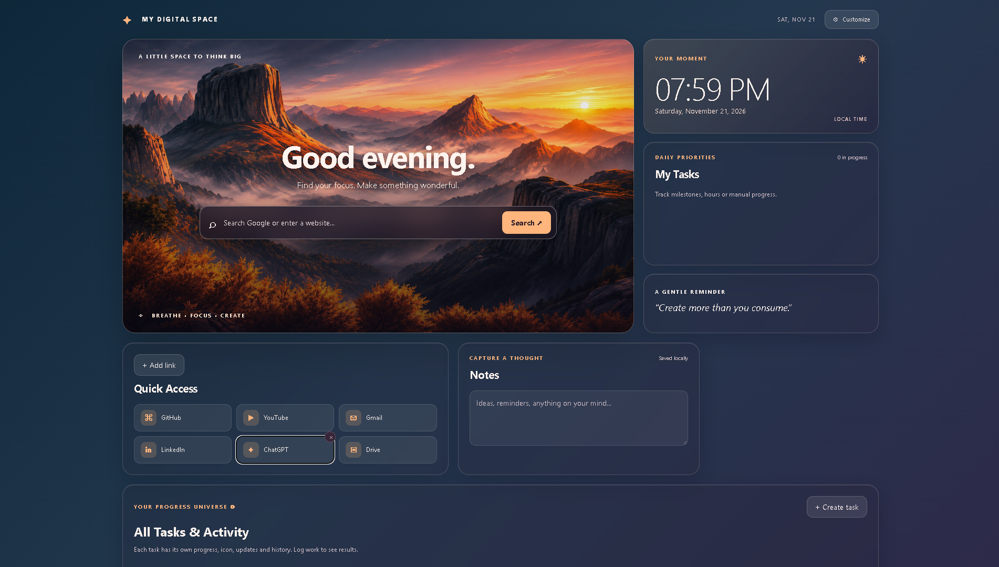

# 🌄 Glass Chrome Homepage

### A Beautiful & Customizable Chrome New Tab Extension

**Developed by Vishwa Tech**

Transform your ordinary Chrome New Tab into a personalized workspace with cinematic wallpapers, glassmorphism design, and productivity features.

---

## ✨ Features

- 🌄 **Cinematic Wallpapers** — Choose from four beautiful backgrounds.
- 🖼️ **Custom Wallpapers** — Upload your own wallpaper from your device.
- 🎨 **Glassmorphism Design** — Customize background styles, colors, and glass effects.
- 🕒 **Live Clock & Date** — Stay updated with a real-time clock.
- 👤 **Personalized Greeting** — Display your preferred name.
- 🔍 **Google Search** — Search directly from your new tab.
- 🔗 **Quick Access** — Open your favorite websites.
- 📝 **Quick Notes** — Save notes directly on your homepage.
- ✅ **Task Management** — Create tasks and track progress.
- 📊 **Progress Tracking** — Monitor individual and combined task progress.
- 💬 **Daily Quotes** — A motivational quote that changes daily.

## 🛠️ Technologies Used

- HTML5
- CSS3
- JavaScript
- Chrome Extensions Manifest V3
- Git & GitHub

## 🚀 Installation

Glass Chrome Homepage is currently available for manual installation.

1. Download this repository using **Code → Download ZIP**.
2. Extract the downloaded ZIP file.
3. Open Google Chrome.
4. Navigate to `chrome://extensions`.
5. Enable **Developer mode**.
6. Click **Load unpacked**.
7. Select the extracted folder containing `manifest.json`.
8. Open a new tab and enjoy your personalized homepage.

## 🔐 Privacy

Glass Chrome Homepage stores your preferences, tasks, notes, and custom wallpapers locally in your browser.

Search queries are sent to Google when you use the search feature.

The extension does not require you to create an account.

## 📦 Current Version

**Version:** 5.2.1

**Status:** Public GitHub release preparation

## 👨‍💻 Developer

**Vishwa Tech**

Built as a personal web development project to explore frontend technologies, Chrome extensions, and user interface design.

## 💡 Feedback

Suggestions and bug reports are welcome!

You can submit feedback through the GitHub Issues section.

---

**Made with ❤️ by Vishwa Tech**

